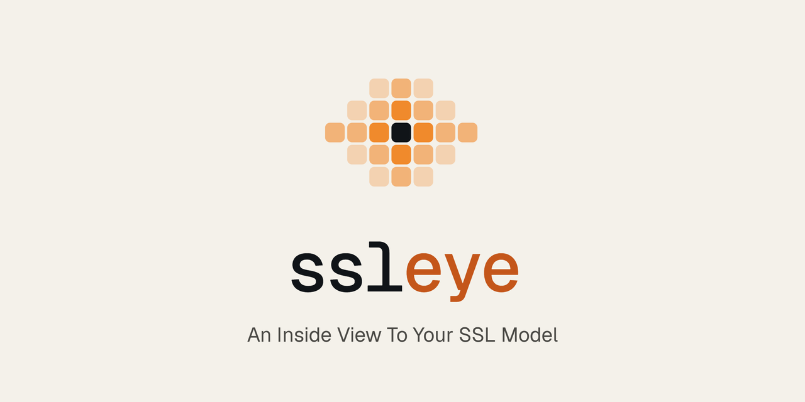

<p align="center">
  <picture>
    <source media="(prefers-color-scheme: dark)" srcset="assets/ssleye-banner-dark.png">
    
  </picture>
</p>

SSLEye lets you watch a self-supervised encoder learn, live or on replay. Add a few calls to your own
training script (SimCLR, BYOL, DINO v1/v2/v3, MAE, I-JEPA, V-JEPA, ...). Snapshots are written to
`ssleye_runs/`, and a local dashboard reads them.

## Install

```bash
pip install git+https://github.com/fherran/ssleye.git
pip install "ssleye[full] @ git+https://github.com/fherran/ssleye.git"   # + scikit-learn (cluster metrics)
```

## Use it in your training script

```python
import ssleye

run = ssleye.init(project="my-data", name="dino-vits", model="dino")   # or "auto"
run.set_probe(probe_images)                      # (N,3,H,W) in [0,1]; labels optional
run.watch(encoder, preprocess=normalize)         # any images -> features module

for step in range(total_steps):
    ...
    run.log(step, loss=loss, config={"lr": lr})  # any values that change over training

run.finish()
```

Then open the dashboard:

```bash
ssleye ui        # http://127.0.0.1:5005  (or: python -m ssleye ui)
```

## Example: the official DINOv3 training loop

Below is `do_train` from [`dinov3/train/train.py`](https://github.com/facebookresearch/dinov3/blob/main/dinov3/train/train.py),
shortened (`...` = unchanged code). Lines marked `# ssleye` are the only additions.

```python
import ssleye                                                          # ssleye
from torchvision.transforms import v2                                  # ssleye

def do_train(cfg, model, resume=False):
    ...
    student = model.student
    iteration = start_iter

    run = ssleye.init(project="imagenet", name="dinov3-vitl16", model="dinov3",       # ssleye
                      snapshot_every=1000)                                            # ssleye
    run.set_probe(probe_images)            # (N,3,H,W) in [0,1], a fixed set of images  # ssleye
    run.watch(model.teacher.backbone,                                                # ssleye
              preprocess=v2.Normalize((0.485, 0.456, 0.406), (0.229, 0.224, 0.225)), # ssleye
              total_params=sum(p.numel() for p in student.parameters()))             # ssleye

    for data in metric_logger.log_every(data_loader, 10, "Training", max_iter, start_iter):
        it = iteration
        ...
        lr = lr_schedule[it]
        wd = wd_schedule[it]
        mom = momentum_schedule[it]
        teacher_temp = teacher_temp_schedule[it]
        ...
        optimizer.zero_grad(set_to_none=True)
        total_loss, metrics_dict = model.forward_backward(data, teacher_temp=teacher_temp, iteration=it)
        ...
        optimizer.step()
        model.update_ema(mom)
        ...
        run.log(it, loss=total_loss, metrics=metrics_dict,                            # ssleye
                config={"lr": lr, "wd": wd, "momentum": mom, "teacher_temp": teacher_temp})  # ssleye
        ...
        iteration = iteration + 1

    run.finish()                                                                      # ssleye
```

- `model.teacher.backbone` is the EMA teacher, the network DINOv3 evaluates. Use `model.student.backbone` to watch the student instead.
- `model="dinov3"` turns on the DINOv3 checks (4 register tokens, RoPE, Gram loss). The loss terms in `metrics_dict` show up as their own charts.
- Probe images are any fixed set of images, e.g. 64 from your validation set, resized to the training resolution.
- Single GPU for now. On a multi-GPU (FSDP) run SSLEye is not supported yet.

## What you get

- **Training view**: the current stage, batch samples with their real crops and masks, and what each network receives.
- **Overview**: loss, effective rank, LiDAR, spread, neighbour stability and other label-free signals, plus alerts.
- **Data & settings**: an input check, throughput, augmentation statistics and every logged schedule.
- **Attention & similarity**: attention on fixed probe images across training, per head and per layer, plus clickable similarity maps.
- **Representation**: the embedding map, nearest neighbours over time and layer CKA.
- **Downstream**: optional kNN, linear and few-shot probes, and which label-free signal tracks them.
- **Alerts**: loss spikes, NaNs, gradient explosions, rank drops, collapse and plateaus.

## Options

- **Labels are optional.** Pass labels to `set_probe` to add kNN accuracy and ✓/✗ per image.
- **Downstream probes:** `run.add_downstream("cifar10", train=(x, y), test=(x, y))`.
- **Stages and batch info:** `ssleye.init(..., stages=[...], batch_info={...})` and `run.set_stage(i, step)`.
- **Model size:** `run.watch(..., total_params=n)` shows the ViT size and parameter count.
- **Alert thresholds:** `ssleye.init(..., alerts={"loss_spike": 3.0})`; the defaults are `DEFAULT_ALERTS` in `ssleye/run.py`.

## License

See [LICENSE](LICENSE).
